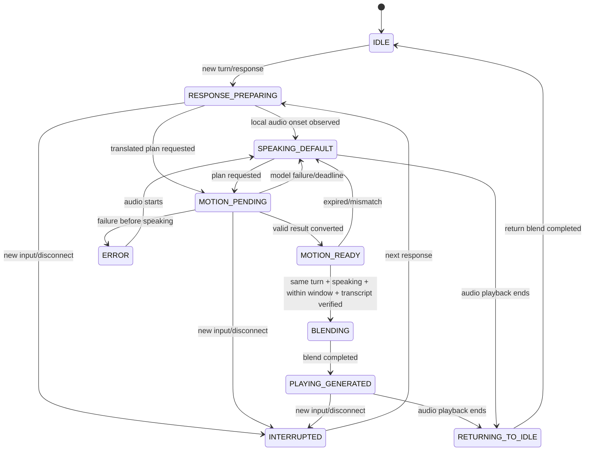

# 対話・発話・動作の状態とシーケンス

会話は `ConversationManager`、GA WebRTCは `RealtimeSpeechEngine`、動作は `GestureScheduler` と `VRMAvatarMotionSink`、計測は `ResearchLog` が担当します。発話状態（PREPARING/SPEAKING/ENDED/INTERRUPTED）と動作状態を分けます。



```mermaid
sequenceDiagram
    participant User as 利用者
    participant Client as ブラウザ・会話管理
    participant Backend as FastAPI
    participant OpenAI as Realtime GA
    participant GPU as モーションキュー／研究室GPU
    participant Scheduler as 音声時計・スケジューラー
    participant VRM as VRM Motion Sink
    User->>Client: 接続を許可
    Client->>Backend: SDP offer
    Backend->>OpenAI: POST /v1/realtime/calls (key on server)
    OpenAI-->>Backend: SDP answer
    Backend-->>Client: SDP answer only
    User->>Client: テキスト／マイク
    Client->>OpenAI: input + response.create (turn metadata)
    par 音声は生成を待たずに再生
        OpenAI-->>Client: WebRTC audio + transcript events
        Client->>Scheduler: local audio signal + audio clock
        Scheduler->>VRM: default gestures + lips
    and 動作の非同期生成
        Client->>Backend: Japanese + actual response transcript
        Backend-->>Client: gesture plan + English prompt
        Client->>Backend: POST motion request
        Backend-->>Client: request_id immediately
        Backend->>GPU: serialized inference
        GPU-->>Backend: full motion (batch)
        Client->>Backend: poll + fetch JSON/VRMA
        Client->>VRM: retarget/official VRMA clip
        Client->>Scheduler: candidate clip + IDs
    end
    alt same turn, still speaking, deadline satisfied
        Scheduler->>VRM: SLERP transition into generated motion
    else late, interrupted, mismatch or failure
        Scheduler->>VRM: continue default; invalidate candidate
    end
    User->>Client: 割り込み
    Client->>OpenAI: response.cancel + output_audio_buffer.clear
    Client->>Backend: cancel/invalidate old motion request
    Client->>Scheduler: invalidate turn epoch
    Scheduler->>VRM: stop and return to neutral
```

Realtimeの生成終了と音声再生終了は別のイベントです。クライアントの音声時計とサーバーのmonotonic時刻は別領域として保存します。VRMファイル・音声録音は自動でサーバーへ保存しません。
