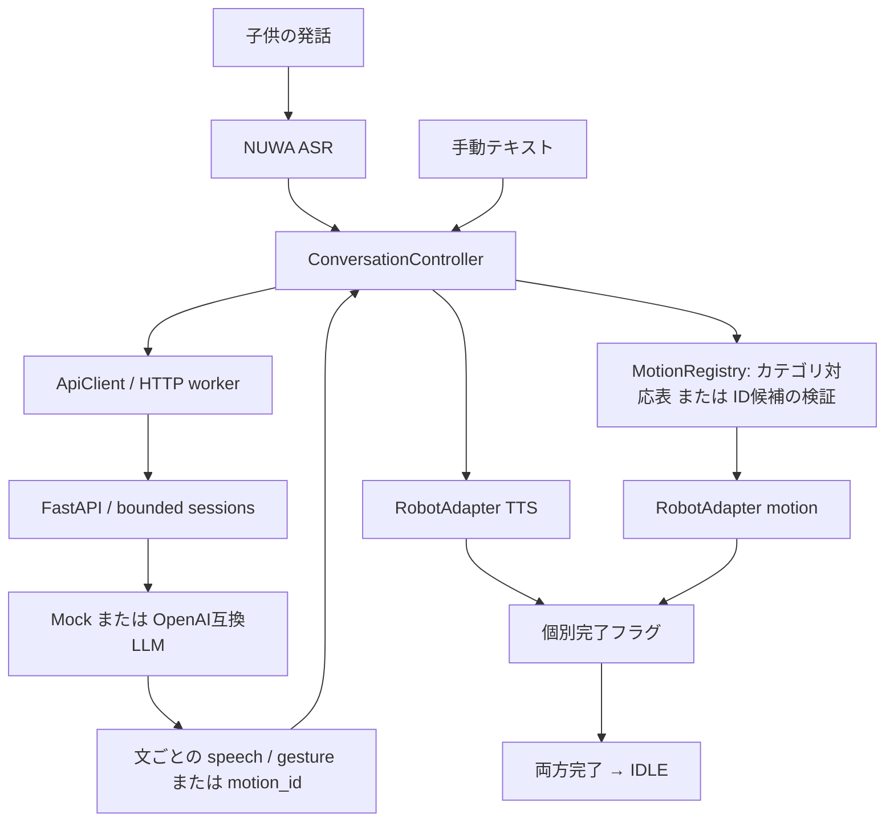

# 構成と責務

## 状態と並行処理

`IDLE → LISTENING → PROCESSING → SPEAKING → IDLE`。
手動入力ではLISTENINGを省略します。ASR単独テストは認識完了でIDLEへ戻ります。
SPEAKING中は文ごとの動作開始通知からTTSを始め、文末で長い動作を止めて次の文へ進みます。単独テスト・旧応答ではTTSとモーションの完了フラグを別々に保持します。動作なしの場合、初めからモーション完了として扱います。
エラーはERRORの通知後に停止・キャンセルしてIDLEへ戻ります。原因コードは画面とJSONログに残ります。

すべての状態変更は同じUIスケジューラーへ集約します。HTTPは専用Executorで実行し、応答はUIへ戻します。
コアは単調時計と遅延スケジューラーを注入する構造で、時間を進める決定的テストが可能です。
ASR 15秒、LLM処理25秒、文ごとの発話・モーション45秒、動作開始通知8秒、文間のSDK再接続10秒で打ち切り、無期限待機やビジーループはありません。
同じモーションのクールダウンは全カテゴリを通じて適用します。同じ返答内の文ごとの再選択は許可します。カテゴリの複数候補は未使用・前回再生が古い順で選びます。

世代番号で停止前のHTTP結果やロボットイベントを無視し、同じ完了・開始イベントは一度だけ受け付けます。
NUWAのコールバックには処理IDがないため、RealRobotAdapterは完了・停止後にSDKインスタンスを破棄して再接続します。
古いインスタンスの通知を接続世代で除外しますが、メーカーサービス内部の再送・配送の保証までは検証できていません。
SDK再接続中は開始操作を無効にします。セッションIDは再接続で変更せず、会話履歴を継続します。

## API契約

`POST /api/respond` はsession_id、text、language、任意のconversation_id（UUID）、available_gesturesを受け取ります。
応答は `speech`（1〜400字）、`gesture`、`language`（en/ja）、`timing`（speech_start）のJSONです。
未知のラベルや端末が利用できないカテゴリはnoneへ変換します。不正JSON・型・言語・タイミング・長すぎる発話は拒否します。
APIのエラー応答やログには入力値や上流のエラー本文を含めません。
`GET /health` と `DELETE /api/sessions/{session_id}` も用意しています。任意の共有トークンを設定できます。

履歴はプロセス内LRU＋非活動期限で保持し、同一セッションのリクエストを直列化します。使用中のセッションは退避しません。
期限切れの除去は次の会話リクエスト時に行います。単一ワーカーの研究用構成です。
複数プロセスへの水平分散、ユーザーごとのアカウント認証、永続データベースは含みません。

## 時間計測

各ターンにランダムUUIDを割り当て、端末はelapsedRealtime、サーバーはtime.monotonicを使います。
ASR開始/完了、LLM要求/応答、TTS要求/開始通知/完了、モーション要求/開始通知/完了を区別します。
metricsにASR・LLM・ターンの時間、発話/モーション開始遅延、両開始通知の時刻差を記録します。
開始通知がない場合の数値は省略し、要求時刻からの指標を別フィールドで記録します。
端末とサーバーの絶対時刻は減算しません。TTS開始要求と実際の音の開始は別の概念です。

## 選択方式

カテゴリ経由（従来7種/拡張15種）と、候補IDをLLMが直接選ぶ方式を要求ごとに選択できます。キーはバックエンドにだけ保持します。条件間の会話履歴は分離し、端末でも条件変更時に新しいセッションを作ります。候補・契約・比較手順は [実験手順](experiments.md) を参照してください。

0.5系の文単位出力と自動聞き取り・停止の仕様は [継続会話](sentence-conversation.md) を参照してください。
