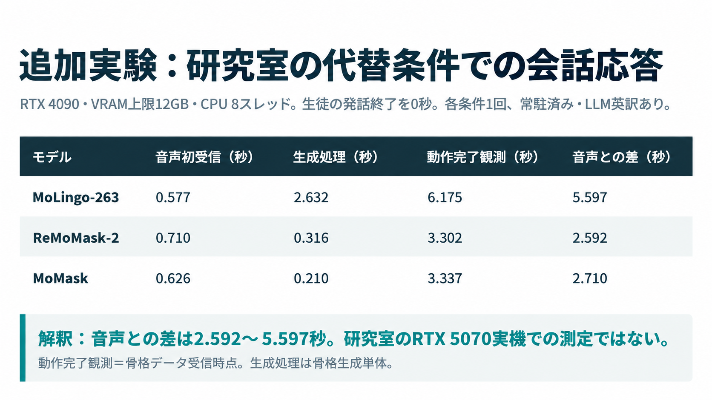
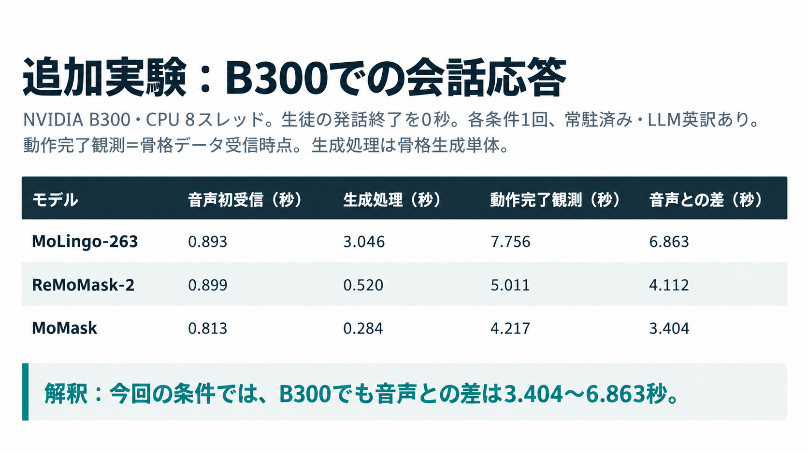
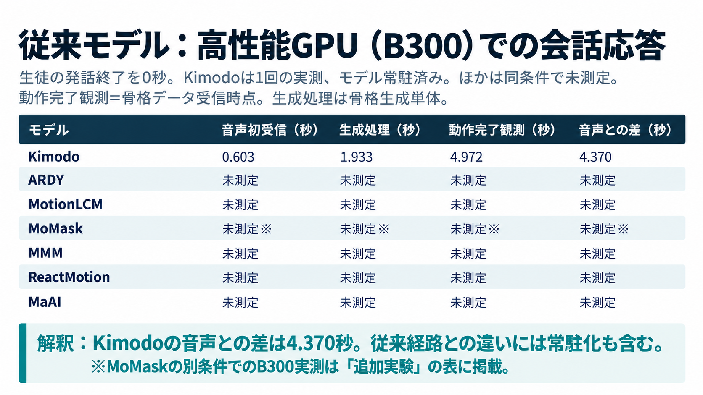

# 会話応答時間の表画像

報告スライドへ貼り付けるためのPNG画像です。単位は秒、生徒の発話終了を0秒とします。

## 追加実験：研究室の代替条件

RTX 4090、VRAM上限12GB、CPU 8スレッド。研究室RTX 5070実機での測定ではありません。各条件1回、モデル常駐済み、LLM英訳あり。

## 追加実験：B300

各条件1回、モデル常駐済み、LLM英訳あり。

## 従来モデル：B300

Kimodoは100ステップの会話実測だけを掲載し、表のモデル名は「Kimodo」としています。同条件で未測定のモデルは未測定と表示しています。MoMaskの別条件でのB300実測は追加実験の表に掲載しています。

## 計測の意味と出典

「生成処理」は会話実行時の骨格生成単体の時間。「動作完了観測」は骨格データを受信した時点で、アニメーション再生終了時点ではありません。「音声との差」は骨格受信と最初の音声受信の差です。丸め前の値から差を計算しています。

- [追加実験の実測CSV](../masked-models-20261016/summary.csv)
- [Kimodo B300会話実測CSV](../kimodo-b300-20261015/dialogue-times.csv)

従来表は常駐化前、追加実験とKimodo B300は常駐化後です。実装経路・英訳の有無などの条件が異なるため、GPU性能だけの比較ではありません。
